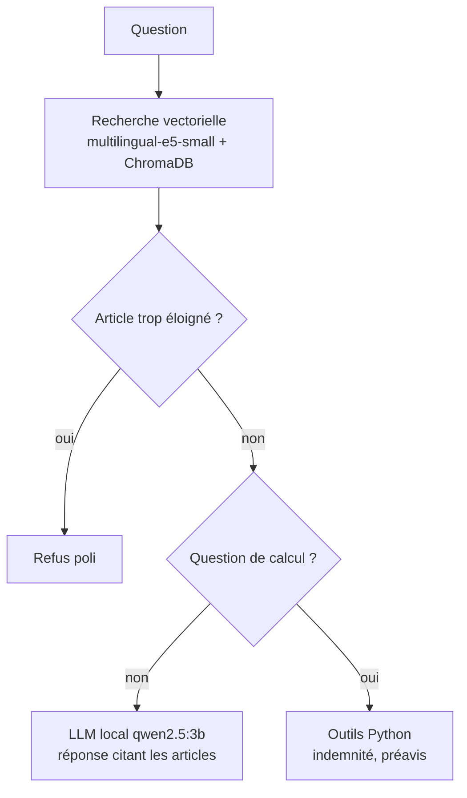

# ⚖️ JuriRH — assistant sur le Code du travail français (100 % local)

JuriRH répond à des questions sur le Code du travail **en citant les articles de loi**,
et calcule l'indemnité légale de licenciement et la durée du préavis.
Tout tourne sur votre machine donc aucun appel à une API externe, aucune donnée envoyée.

> ⚠️ Information générale, pas un conseil juridique. Les montants sont indicatifs :
> une convention collective peut être plus favorable.


## Fonctionnalités

- **Questions de droit (RAG)** : recherche des articles pertinents, puis réponse du modèle
  basée uniquement sur ces articles, avec citation des numéros et lien Légifrance.
- **Calculs fiables** : l'indemnité de licenciement (L1234-9, R1234-2, L1226-14) et le préavis
  (L1234-1, L1237-1) sont calculés en Python, jamais « de tête » par le modèle.
- **Refus hors sujet** : si la question est trop éloignée du Code du travail, l'assistant refuse
  sans appeler le modèle (seuil de distance calibré sur des questions réelles).
- **Réponse en direct** (streaming) dans une interface Streamlit.

## Comment ça marche



- **Données** : dataset Hugging Face `louisbrulenaudet/code-travail`, articles en vigueur uniquement,
  nettoyés, dédoublonnés, découpés avec chevauchement.
- **Modèle** : `qwen2.5:3b` via Ollama (choisi car il gère les appels d'outils).

## Installation

Prérequis : Python 3.14 (testé), [Ollama](https://ollama.com).

```powershell
git clone https://github.com/Nesnisse24/assistant_rag.git
cd assistant_rag
python -m venv .venv
.venv\Scripts\Activate.ps1
pip install -r requirements.txt

ollama pull qwen2.5:3b
python src/ingest.py court      # crée la base vectorielle (long, une seule fois)
python test_setup.py            # vérifie que tout fonctionne
streamlit run app.py
```

## Tests et évaluation

```powershell
python -m pytest tests -v            # tests des calculs (bornes, cas limites)
python eval/seuil.py                 # distances des questions du domaine vs hors sujet
python eval/eval_retrieval.py        # qualité de la recherche
python eval/run_eval.py qwen2.5:3b   # évaluation complète (long)
```

### Résultats (27 questions : 15 de droit, 6 de calcul, 6 hors sujet)

| Version | Droit OK | Calculs | Hors sujet refusés | Temps moyen |
|---|---|---|---|---|
| llama3.2:3b | 6/15 | 6/6 | 6/6 | 37 s |
| qwen2.5:3b, sans garde-fou | 10/15 | 5/6 | 1/6 | 31 s |
| **qwen2.5:3b (retenu)** | **10/15** | **6/6** | **6/6** | 47 s |
| qwen2.5:7b | 6/15 | 5/6 | 6/6 | 559 s |

*« Droit OK » exige l'article attendu dans le top 5, aucun faux refus et des citations valides.
Les exécutions ne tournaient pas toutes avec la même version du code (le test du 7b précède
le garde-fou par seuil) : comparaison indicative.*

À retenir :
- Le **garde-fou par seuil** fait passer les refus hors sujet de 1/6 à 6/6
  (distance max du domaine 0,121 ; min hors sujet 0,176 ; seuil 0,15).
- Le modèle 7b n'apporte rien de plus ici et est bien plus lent.

## Limites connues

- Modèle de 3 milliards de paramètres, peut mal rédiger ou oublier de citer un article.
- 3 questions de droit sur 15 échouent à cause de la recherche (durée maximale d'un CDD,
  congé maternité, cas de recours au CDD) et l'article attendu n'est pas dans les 5 premiers résultats.
- Faute grave ou lourde, conventions collectives et cas particuliers ne sont pas gérés.
- Pas de mémoire de conversation (« et avec 12 ans ? » n'est pas compris).
- Temps de réponse de l'ordre de quelques dizaines de secondes sur CPU.

## Structure du projet

```
app.py              interface Streamlit
src/
  ingest.py         téléchargement, nettoyage et indexation du Code du travail
  rag.py            recherche vectorielle, seuil de refus, génération
  agent.py          routage : droit, calcul ou refus
  tools.py          calculs d'indemnité et de préavis
tests/              tests unitaires des calculs
eval/               scripts et résultats d'évaluation
```